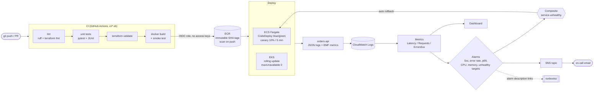

# AWS CI/CD and Observability for Container Workloads

A reference delivery pipeline and observability baseline for a containerized service on AWS: lint → test → build → push → blue/green or rolling deploy, with CloudWatch metrics, alarms, a dashboard, and runbooks that make an automatic rollback possible.

> **Portfolio disclaimer:** sample/demo code inspired by my professional work on CI/CD and monitoring for cloud-native AWS workloads. No client code, names, or data. The service is a deliberately small FastAPI app so the delivery and observability patterns stay the focus.

## Architecture



## What recruiters / reviewers should notice

- **Metrics without an agent.** The app writes CloudWatch [Embedded Metric Format](https://docs.aws.amazon.com/AmazonCloudWatch/latest/monitoring/CloudWatch_Embedded_Metric_Format.html) in its normal log line, so latency, request, and 5xx metrics appear in CloudWatch with no sidecar, StatsD, or custom `PutMetricData` calls. A log metric filter counts 5xx independently as a backup signal.
- **Alarms that page on impact, not noise.** Error *rate* via metric math (5xx ÷ requests), p99 latency with `datapoints_to_alarm`, `treat_missing_data = notBreaching`, and OK notifications so the channel shows recovery.
- **Deploys that roll themselves back.** A composite `service-unhealthy` alarm is the rollback trigger for CodeDeploy's ECS canary. Every log line carries `version` and `color`, so "is it the new release?" is one Logs Insights query.
- **No long-lived CI credentials.** GitHub Actions assumes an IAM role through OIDC, restricted to this repo's `main` branch and `dev` environment. `iam:PassRole` is scoped to the two task roles and `ecs-tasks.amazonaws.com`.
- **Supply-chain basics.** Immutable ECR tags (git SHA), scan on push, lifecycle expiry, non-root container with a read-only root filesystem, and an image smoke test before push.
- **Runbooks wired to alarms.** Every alarm description names the runbook to open.
- **Same commands locally and in CI.** The workflow only calls `ci/*.sh`, so a failing pipeline can be reproduced on a laptop.

## Layout

```
app/                       FastAPI service, Dockerfile, pytest suite
ci/                        lint.sh, test.sh, terraform-validate.sh, docker-build.sh, deploy-smoke.sh, all.sh
infra/
  modules/observability/   log group, metric filter, Logs Insights queries, SNS, alarms, composite alarm, dashboard
  modules/delivery/        ECR, GitHub OIDC deploy role, ECS task execution + task roles
  envs/dev/                composes both modules for one environment
deploy/
  ecs/                     Fargate task definition template + CodeDeploy blue/green AppSpec
  k8s/                     rolling-update Deployment + PodDisruptionBudget for EKS
runbooks/                  one runbook per alarm family
docs/ci/                   intended GitHub Actions workflow (github-actions.yml.example)
```

## Run it locally

```bash
python -m venv .venv && source .venv/bin/activate
pip install -r app/requirements-dev.txt

./ci/all.sh                      # lint, tests, terraform validate, docker build (skipped if no daemon)

uvicorn app.main:app --port 8080
curl -s localhost:8080/readyz
curl -s -XPOST localhost:8080/api/v1/orders -H 'content-type: application/json' -d '{"sku":"SKU-1","quantity":2}'
```

Each request prints one JSON line; the `_aws` block is what CloudWatch turns into metrics.

`ci/docker-build.sh` builds the image, runs it, and checks `/healthz` and `/readyz` before anything can be pushed. On a machine with no Docker daemon it prints a warning and exits 0 so the other stages still run.

## Deploy the AWS side

```bash
cd infra/envs/dev
cp terraform.tfvars.example terraform.tfvars   # on-call email, optional ECS cluster/service
terraform init
terraform plan -out=tfplan
terraform apply tfplan
```

The dev stack is **low-cost by design**: a log group, metric filter, SNS topic, a handful of alarms, a dashboard, an ECR repository, and IAM roles. No compute, NAT, or load balancer is created here. Point `ecs_cluster_name` / `ecs_service_name` at an existing service to turn on the container alarms and dashboard widgets. Email subscribers must confirm the SNS subscription.

Then set the `DEPLOY_ROLE_ARN` repository variable to the `deploy_role_arn` output.

### Deployment strategies

| | ECS Fargate (blue/green) | EKS (rolling) |
|---|---|---|
| Files | `deploy/ecs/taskdef.template.json`, `deploy/ecs/appspec.yaml` | `deploy/k8s/deployment.yaml` |
| Traffic shift | CodeDeploy `ECSCanary10Percent5Minutes` through an ALB test listener | `maxSurge: 1`, `maxUnavailable: 0`, readiness on `/readyz` |
| Gate | `AfterAllowTestTraffic` hook + `ci/deploy-smoke.sh` check the new version | rollout `progressDeadlineSeconds` |
| Rollback | automatic on composite alarm or failed hook | `kubectl rollout undo` (or Argo Rollouts analysis) |

The EKS path assumes a cluster like the one in my [aws-eks-platform-terraform](https://github.com/suranjana14/aws-eks-platform-terraform) repo.

## CI

The intended workflow is in [`docs/ci/github-actions.yml.example`](docs/ci/github-actions.yml.example). Copy it to `.github/workflows/ci-cd.yml` to enable it. It has three jobs:

1. **build-test** on every PR and push: `ci/lint.sh`, `ci/test.sh` (JUnit artifact), `ci/terraform-validate.sh`.
2. **image** on `main`: OIDC into AWS, ECR login, `ci/docker-build.sh` with `PUSH=1`.
3. **deploy-dev**: renders the task definition with the new image and runs a CodeDeploy blue/green deployment, waiting for service stability. A prod job would be the same with a protected `prod` environment (required reviewers).

## Roadmap
- Service Auto Scaling target tracking on request count per target
- AWS X-Ray / OpenTelemetry tracing alongside the EMF metrics
- CloudWatch Synthetics canary on `/readyz`
- Checkov and Trivy scans in the build-test job
